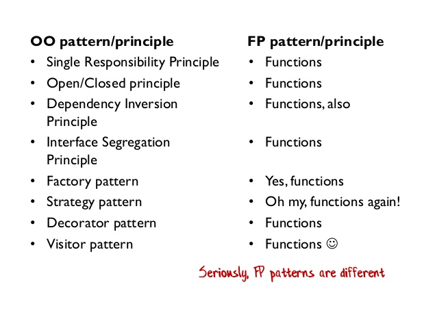
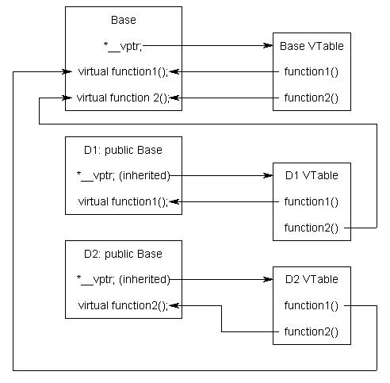
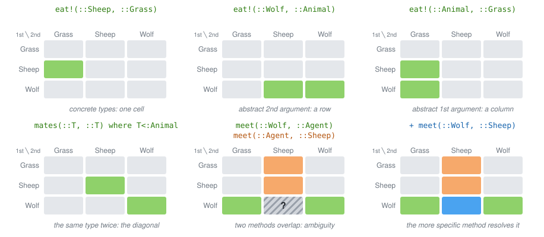

# Design patterns: good practices and structured thinking

Every software developer has a desire to write better code. A desire
to improve system performance. A desire to design software that is easy to maintain, easy to understand and explain.

Design patterns are recommendations and good practices accumulating knowledge of experienced  programmers.

The highest level of experience contains the design guiding principles:
- **SOLID:** Single Responsibility, Open/Closed, Liskov Substitution, Interface Segregation, Dependency Inversion
- **DRY:** Don't Repeat Yourself
- **KISS:** Keep It Simple, Stupid!
- **POLA:** Principle of Least Astonishment
- **YAGNI:** You Aren't Gonna Need It (overengineering)
- **POLP:** Principle of Least Privilege 

While these high-level concepts are intuitive, they are too general to give specific answers.

More detailed patterns arise for programming paradigms (declarative, imperative) with specific instances of functional or object-oriented programming.

The concept of design patterns originates in the OOP paradigm. OOP defines a strict way how to write software. Sometimes it is not clear how to squeeze real world problems into those rules.  Cookbook for many practical situations

- Gamma, E., Helm, R., Johnson, R., & Vlissides, J. (1995). Design patterns: elements of reusable object-oriented software. Addison-Wesley.

Defining 23 design patterns in three categories. Became extremely popular.


(C) Scott Wlaschin


Is julia OOP or FP? It is different from both, based on:

- types system (polymorphic)
- multiple dispatch (extending single dispatch of OOP)
- functions as first class 
- decoupling of data and functions
- macros

Any guidelines to solve real-world problems?

- Hands-On Design Patterns and Best Practices with Julia Proven solutions to common problems in software design for Julia 1.x Tom Kwong, CFA


Fundamental tradeoff: rules vs. freedom

- freedom: in the C language it is possible to access assembler instructions, use pointer arithmetics:
    - it is possible to write extremely efficient code
    - it is easy to segfault, leak memory, etc.
- rules: in strict languages (strict OOP, strict functional programming) you lose freedom for certain guarantees:
    - e.g. strict functional programming guarantees that the program provably terminates
    - operations that are simple e.g. in pointer arithmetics may become clumsy and inefficient in those strict rules.
    - the compiler can validate the rules and complain if the code does not comply with them. 

Julia is again a dance between freedom and strict rules. It is more inclined to freedom. 
Provides few simple concepts that allow to construct design patterns common in other languages.

- the language does not enforce too many formalisms (via keywords (interface, trait, etc.) but they can be 
    - the compiler cannot check for correctness of these "patterns"
    - the user has a lot of freedom (and responsibility)
- lots of features can be added by Julia packages (with various level of comfort)
    - macros


## Design Patterns of OOP from the Julia viewpoint

OOP is currently very popular concept (C++, Java, Python).  It has strengths and weaknesses. The Julia authors tried to keep the strength and overcome weaknesses. 

Key features of OOP:

- Encapsulation 
- Inheritance 
- Polymorphism 

Classical OOP languages define classes that bind processing functions to the data. Virtual methods are defined only for the attached methods of the classes.

::: tip Encapsulation

Refers to bundling of data with the methods that operate on that data, or the restricting of direct access to some of an object's components. Encapsulation is used to hide the values or state of a structured data object inside a class, preventing direct access to them by clients in a way that could expose hidden implementation details or violate state invariance maintained by the methods. 

:::

::: tip Making Julia to mimic OOP

There are many discussions how to make Julia to behave like an OOP. The best implementation to our knowledge is [ObjectOriented](https://github.com/Suzhou-Tongyuan/ObjectOriented.jl)

:::

### Encapsulation Advantage: Consistency and Validity 

With fields of data structure freely accessible, the information may become inconsistent.

```julia
abstract type Plant end
mutable struct Grass <: Plant
    id::Int
    size::Int
    max_size::Int
end
```

What if I create Grass with larger size than ```max_size```?

```julia
grass = Grass(1,50,5)
```

Freedom over Rules. Maybe I would prefer to introduce some rules.

Some encapsulation may be handy keeping it consistent. Julia has ```inner constructor```.

```julia
mutable struct Grass2 <: Plant
    id::Int
    size::Int
    max_size::Int
    Grass2(id,sz,msz) = sz > msz ? error("size can not be greater that max_size") : new(id,sz,msz)
end
```

When defined, Julia does not provide the default outer constructor. 

But fields are still accessible:

```julia
grass2 = Grass2(1,5,5)
grass2.size = 10000
```

Recall that `grass2.size=10000` is a syntax of `setproperty!(grass2,:size,10000)`, which can be redefined:

```julia
function Base.setproperty!(obj::Grass2, sym::Symbol, val)
    if sym==:size
        @assert val<=obj.max_size "size have to be lower than max_size!"
    end
    setfield!(obj,sym,val)
end
```

Function `setfield!` can not be overloaded.

Some fields should never change. Since Julia 1.8, fields of a mutable struct can be `const`:

```julia
mutable struct Grass3 <: Plant
    const id::Int
    size::Int
    const max_size::Int
end
```

`grass3.id = 2` is an error, `grass3.size = 2` is fine.

Julia has *partial encapsulation* via a mechanism for consistency checks. 

Similarly for modules: since Julia 1.11, keyword `public` marks the API of a module without exporting it. Everything else is still accessible, by convention not used.

::: warning Array in imutable struct can be mutated

The mutability applies to the structure and not to encapsulated structures.

```julia
struct Foo
    x::Float64
    y::Vector{Float64}
    z::Dict{Int,Int}
end
```

In the structure `Foo`, `x` cannot be mutated, but fields of `y` and key-value pairs of `z` can be mutated, because they are mutable containers. But I cannot replace `y` with a different `Vector`.

:::

### Encapsulation Disadvantage: the Expression Problem 

Encapsulation limits the operations I can do with an object. Sometimes too much. Consider a matrix of methods/types(data-structures)

Consider an existing matrix of data and functions:

| data \ methods | find_food | eat! | grow! |
| :--            | ---       | ---  | ---   |
| Wolf           |           |      |       |
| Sheep          |           |      |       |
| Grass          |           |      |       |

You have a good reason not to modify the original source (maintenance).

Imagine we want to extend the world to use new animals and new methods for all animals.

Object-oriented programming 

- classes are primary objects (hierarchy)
- define animals as classes ( inheriting from abstract class)
- adding a new animal is easy
- adding a new method for all animals is hard (without modifying the original code)

Functional programming

- functions are primary
- define operations ```find_food```, ```eat!```
- adding a new operation is easy
- adding new data structure to existing operations is hard

Solutions:

1. multiple-dispatch = julia
2. open classes (monkey patching) = add methods to classes on the fly
3. visitor pattern = partial fix for OOP [extended visitor pattern using dynamic_cast]

### Morale:

- Julia does not enforces creation getters/setters by default  (setproperty is mapped to setfield)
- it provides tools to enforce access restriction if the user wants it.
- can be used to imitate objects: 
https://stackoverflow.com/questions/39133424/how-to-create-a-single-dispatch-object-oriented-class-in-julia-that-behaves-l/39150509#39150509

## Polymorphism: 

::: tip Polymorphism in OOP

Polymorphism is the method in an object-oriented programming language that performs different things as per the object’s class, which calls it. With Polymorphism, a message is sent to multiple class objects, and every object responds appropriately according to the properties of the class. 

:::

Example animals of different classes make different sounds. In Python:

```python
class Sheep:
    def __init__(self, energy, Denergy):
        self.energy = energy
        self.Denergy = Denergy

    def make_sound(self):
        print("Baa")

sheep.make_sound()
wolf.make_sound()
```

Will make distinct sounds (baa, Howl). 

Can we achieve this in Julia?

```julia
make_sound(::Sheep) = println("Baa")
make_sound(::Wolf) = println("Howl")
```

::: tip Implementation of virtual methods

Virtual methods in OOP are typically implemented using Virtual Method Table, one for each class.


Julia has a single method table. Dispatch can be either static or dynamic (slow).

:::

*Freedom* vs. Rules. 

- Duck typing is a type of polymorphism without static types
    - more  programming freedom, less formal guarantees
- julia does not check if ```make_sound``` exists for all animals. May result in `MethodError`. Responsibility of a programmer.
    - define ```make_sound(A::AbstractAnimal)```

So far, the polymorphism coincides for OOP and julia because the method had only one argument => single argument dispatch.

Multiple dispatch is an *extension* of the classical first-argument-polymorphism of OOP, to all-argument polymorphism.


::: tip Challenge for OOP

How to code polymorphic behavior of interaction between two agents, e.g. an agent eating another agent in OOP?

Complicated.... You need a "design pattern" for it.

:::

```python
class Sheep(Animal):
    energy: float = 4.0
    denergy: float = 0.2
    reprprob: float = 0.5
    foodprob: float = 0.9

    # hard, if not impossible to add behaviour for a new type of food
    def eat(self, a: Agent, w: World):
        if isinstance(a, Grass):
            self.energy += a.size * self.denergy
            a.size = 0
        else:
            raise ValueError(f"Sheep cannot eat {type(a).__name__}.")
```

Consider an extension to:
- Flower : easy
- PoisonousGrass: harder

Simple in Julia:

```julia
eat!(w1::Sheep, a::Grass, w::World)=
eat!(w1::Sheep, a::Flower, w::World)=
eat!(w1::Sheep, a::PoisonousGrass, w::World)=
```

Boiler-plate code can be automated by macros / meta programming.

Methods tile the space of argument types (ignoring `w::World`): rows are the 1st argument, columns the 2nd.



What happens with `meet(Wolf(), Sheep())` in the middle panel?

## Inheritance

::: tip Inheritance

Is the mechanism of basing one object or class upon another object (prototype-based inheritance) or class (class-based inheritance), retaining similar implementation. Deriving new classes (sub classes) from existing ones such as super class or base class and then forming them into a hierarchy of classes. In most class-based object-oriented languages, an object created through inheritance, a "child object", acquires all the properties and behaviors of the "parent object" , with the exception of: constructors, destructor, overloaded operators.

:::

Most commonly, the sub-class inherits methods and the data.

For example, in python we can design a sheep with additional field.
Think of a situation that we want to refine the reproduction procedure for sheeps by considering differences for male and female. We do not have information about gender in the original implementation. 

In OOP, we can use *inheritance*.

```python
class Sheep:
    def __init__(self, energy, Denergy):
        self.energy = energy
        self.Denergy = Denergy

    def make_sound(self):
        print("Baa")

class SheepWithGender(Sheep):
    def __init__(self, energy, Denergy,gender):
        super().__init__(energy, Denergy)
        self.gender = gender
    # make_sound is inherited 

# Can you do this in Julia?!
```

Simple answer: NO, not exactly

- Sheep has fields, is a **concrete** type, we cannot extend it.
    - with modification of the original code, we can define AbstractSheep with subtypes Sheep and SheepWithGender.
- But methods for AbstractAnimal works for sheeps! Is this inheritance?


### Inheritance vs. Subtyping

Subtle difference:

- subtyping = equality of interface 
- inheritance = reuse of implementation 

In practice, subtyping reuse methods, *not* data fields.

We have seen this in Julia, using type hierarchy: 

- ```agent_step!(a::Animal, w::World)```
- all animals subtype of ```Animal``` "inherit" this method.

The type hierarchy is only one way of subtyping. Julia allows many variations, e.g. concatenating different parts of hierarchies via the ```Union{}``` type:

```julia
fancy_method(O::Union{Sheep,Grass}) = println("Fancy")
```

Is this a good idea? It can be done completely Ad-hoc! Freedom over Rules.

There are very good use-cases:

- Missing values:
```x::AbstractVector{<:Union{<:Number, Missing}}```

::: danger SubTyping issues

With parametric types, unions and other construction, subtype resolution may become a complicated problem. Julia can even crash.
[Jan Vitek's Keynote at JuliaCon 2021](https://www.youtube.com/watch?v=LT4AP7CUMAw)

:::

### Sharing of data field via composition
Composition is also recommended in OOP: [Composition over inheritance](https://en.wikipedia.org/wiki/Composition_over_inheritance)

```julia 
struct ⚥Sheep <: Animal
    sheep::Sheep
    sex::Symbol
end
```

If we want our new ⚥Sheep to behave like the original Sheep, we need to *forward* the corresponding methods.

```julia
eat!(a::⚥Sheep, b::Grass, w::World)=eat!(a.sheep, b, w)
```
and all other methods. Routine work. Boring!  
The whole process can be automated using macro ```@forward``` from MacroTools.jl (we will write it ourselves in lecture 6):

```julia
using MacroTools: @forward
@forward ⚥Sheep.sheep eat!, reproduce!
```


## Functional tools: Partial evaluation

It is common to create a new function which "just" specify some parameters.

```julia
_prod(x) = reduce(*,x)
_sum(x) = reduce(+,x)
``` 

Base has a type for fixing an argument:

```julia
half = Base.Fix2(/, 2)        # x -> x / 2
half(10)
map(Base.Fix1(+, 1), [1,2,3])
Base.Fix{3}(clamp, 1.0)       # fix any argument, since Julia 1.12
```

Why a type and not just an anonymous function?

## Functional tools: Closures

### Motivation: talking to a library

Recall the optimization from lecture 1:

```julia
using Optim

P(x,y) = x^2 - 3x*y + 5y^2 - 7y + 3
f(z) = P(z...)

optimize(f, [0.0, 0.0], BFGS(), Optim.Options(callback = cb))
```

Optim calls *our* function after every iteration, `callback(state)`, return `true` to stop.

How to store the history of the objective? `optimize` knows nothing about our storage.

```julia
trace = Float64[]
function cb(state)
    push!(trace, state.f_x)
    return false
end

optimize(f, [0.0, 0.0], BFGS(), Optim.Options(callback = cb))
trace
```

Stop early, when the objective is below a threshold:

```julia
stop_below(t) = state -> state.f_x < t

optimize(f, [0.0, 0.0], BFGS(), Optim.Options(callback = stop_below(0.0)))
```

`stop_below(0.0)` returns a function of `state` only. Where is `t` stored?

The same pattern for the objective itself. Fitting a line to data: the library wants `f(θ)`, we have `loss(θ, xs, ys)`:

```julia
loss(θ, xs, ys) = sum(abs2, θ[1] .* xs .+ θ[2] .- ys)

optimize(θ -> loss(θ, xs, ys), [0.0, 0.0], BFGS())
```

Note that function ```optimize``` does not need to know about the data. The important variables exist in the scope from which the function was invoked.

### Closure

::: tip Closure (lexical closure, function closure)

A technique for implementing lexically scoped name binding in a language with first-class functions. Operationally, a closure is a record storing a function together with an environment.

:::

- originates in functional programming
- now widespread in many common languages, Python, Matlab, etc..
- memory management relies on garbage collector in general (can be optimized by compiler)

### Example

```julia
function adder(x)
    return y->x+y
end
```

creates a function that "closes" the argument ```x```. Try: ```f=adder(5); f(3)```.

```julia
x = 30;

function adder()
    return y->x+y
end
```

creates a function that "closes" variable ```x```.

```julia
f = adder(10)
f(1)

g = adder()
g(1)
```

Such function can be passed as an argument: *together* with the closed data.

### Implementation of closures in julia: documentation

Closure is a record storing a function together with an environment. The environment is a mapping associating each *free* variable of the function (variables that are used locally, but defined in an enclosing scope) with the value or reference to which the name was bound when the closure was created.

```julia
function adder(x)
    return y->x+y
end
```

is lowered to (roughly):

```julia
struct var"#adder##0#adder##1"{T} <: Function
    x::T
end

(f::var"#adder##0#adder##1")(y) = f.x + y

function adder(x)
    return %new(var"#adder##0#adder##1"{typeof(x)}, x)   # no constructor, internal %new
end
```

The struct is created when `adder` is *defined*. It is visible when lowering the definition:

```julia
Meta.@lower function adder(x)
    return y -> x + y
end
```

```julia
Core._structtype(Main, Symbol("#adder##0#adder##1"), svec(T), svec(:x), ...)
Core._setsuper!(%5, Core.Function)
...
%new(var"#adder##0#adder##1"{typeof(x)}, x)
```

and in the body of the compiled method, `@code_lowered adder(5)` or `@code_typed adder(5)`.

The name changes with every definition.

Try ```f.x``` and ```g.x```:

```julia
f.x        # 10
typeof(f)  # var"#adder##0#adder##1"{Int64}
dump(f)

g.x        # FieldError: ... has no fields at all
```

- `f` stores `x`, the struct is a real object with a field
- the struct has no constructor, it cannot be created except by `adder`
- `g` stores nothing: global `x` is read when `g` is called. Change `x = 40` and call `g(1)` again.

### Functor = Function-like structure

Each structure can have a method that is invoked when called as a function.

```julia
(_::Sheep)()= println("🐑")

```
You can think of it as ```sheep.default_method()```.

A closure is a functor generated by the compiler.

## Usage

Usage of closures:

- callbacks: the function can also modify the enclosed variable.
- abstraction: partial evaluation 

::: danger Beware: Performance of captured variables

Inference of types may be difficult in closures: https://github.com/JuliaLang/julia/issues/15276    

```julia
function counter()
    n = 0
    return () -> (n += 1)
end
c = counter()
c(); c()
typeof(c.n)   # Core.Box
```

A captured variable that is reassigned is stored in a `Core.Box`, its type is unknown to the compiler.

Fixes:

- the variable has to change: keep the binding, mutate a typed container
  ```julia
  function counter()
      n = Ref(0)
      return () -> (n[] += 1)   # captures RefValue{Int}, no Box
  end
  ```
- the variable is reassigned only before the closure: rebind with `let`
  ```julia
  function abmult(r::Int)
      if r < 0
          r = -r
      end
      return let r = r
          x -> x * r            # captures Int, no Box
      end
  end
  ```
- type annotation `n::Int = 0` keeps the Box, but its content is known (partial fix)

Detect with `@code_warntype` (look for `Core.Box`).

:::

## Additional materials
 * [The Art of Multiple Dispatch](https://scientificcoder.com/the-art-of-multiple-dispatch) by Matthijs Cox: dispatch as slices of the type space, the idea behind the grid above
 * [Functional design patterns](https://www.youtube.com/watch?v=srQt1NAHYC0)
