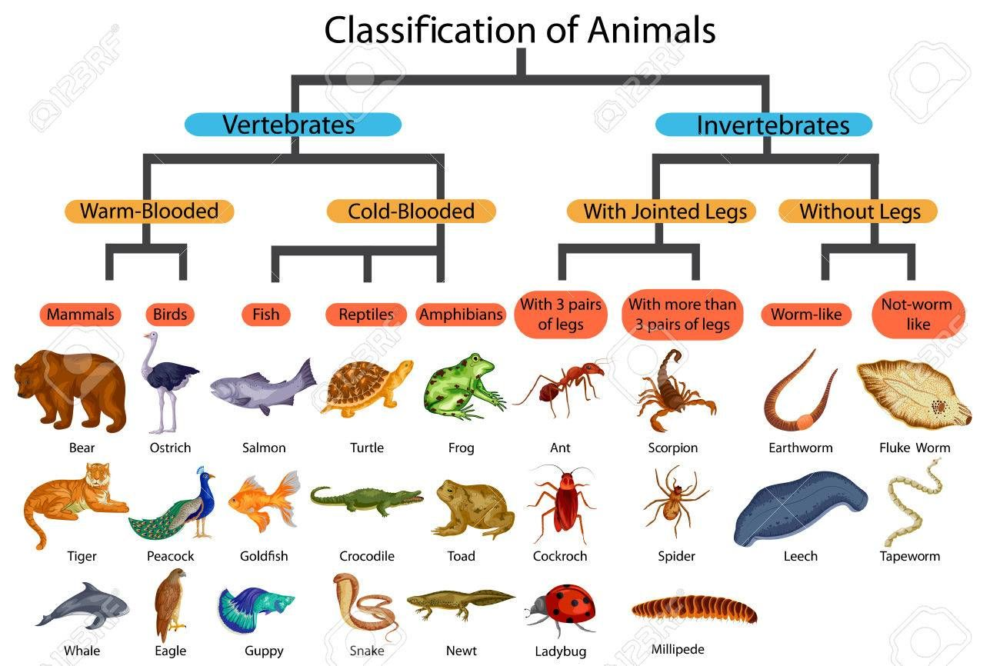
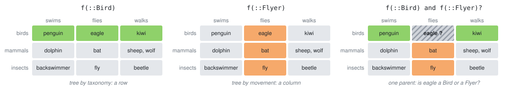

# Design patterns II: interfaces and traits

Composition (last lecture) needed forwarding of all methods. Why so complicated? Wasn't the original inheritance tree structure better?

- multiple inheritance:
    - you just compose two different "trees".
    - common example with ArmoredVehicle = Vehicle + Weapon
- Do you think there is only one sensible inheritance tree?

::: tip Animal World

Think of an inheritance tree of a full scope Animal world.

Idea #1: Split animals by biological taxonomy


Hold on. 
- Sharks and dolphins can swim very well!
- Both bats and birds fly similarly!

Idea #2: Split by the way they move!

Idea #3: Split by way of ...

:::

In fact, we do not have a tree, but more like a matrix/tensor:

|        | swims       | flies | walks      |
| :--    | ---         |  ---  | ---        | 
| birds  | penguin     | eagle | kiwi       |
| mammal | dolphin     | bat   | sheep, wolf|
| insect | backswimmer | fly   | beetle     |

An abstract type of a tree dispatches a whole row, or a whole column, depending on which tree we choose:



A bat and an eagle both fly, but they do not share a parent type. How do we dispatch on *can fly*?

The answer is a *trait*: a property of a type that dispatch can read. Later we will see that Julia itself uses the same trick to organize *interfaces*.

## Traits: cherry picking subtyping

Option 1: analyze what features of animals are common and *compose* the animal with type parameters (as `Animal{Sheep}` in lab 3):

```julia
abstract type HeatType end
abstract type MovementType end
abstract type ChildCare end

mutable struct Animal{H<:HeatType,M<:MovementType,C<:ChildCare} 
    id::Int
    ...
end
```

Now, we can define methods dispatching on parameters of the main type.

- all features have to be known when `Animal` is defined
- a new feature changes the type, and all methods written for it
- is movement a property of the *individual* or of the *species*?

Option 2: keep the biological tree and add the features later, as traits:

```julia
abstract type Animal end
abstract type Bird <: Animal end
abstract type Mammal <: Animal end
struct Eagle <: Bird end
struct Penguin <: Bird end
struct Bat <: Mammal end
struct Dolphin <: Mammal end
struct Sheep <: Mammal end
```

Trait mechanism in Julia is built using the existing tools: Type System and Multiple Dispatch.

Traits have a few key parts:

- Trait types: the different traits a type can have.
- Trait function: what traits a type has.
- Trait dispatch: using the traits.

Add movement as a trait:

```julia
# trait types
abstract type Movement end
struct Flies <: Movement end
struct Swims <: Movement end
struct Walks <: Movement end

# trait function: input is a Type, output is an instance of a trait type
Movement(a::Animal) = Movement(typeof(a))
Movement(::Type{<:Animal}) = Walks()    # default
Movement(::Type{Eagle}) = Flies()
Movement(::Type{Bat}) = Flies()
Movement(::Type{Penguin}) = Swims()
Movement(::Type{Dolphin}) = Swims()

# trait dispatch
move(a::Animal) = move(Movement(a), a)
move(::Flies, a) = "flies"
move(::Swims, a) = "swims"
move(::Walks, a) = "walks"
```

- `Bat` and `Eagle` share behavior without sharing a parent.
- The trait was added *after* the types were defined, without touching them.
- Should there be a default? What happens without it?

Two traits at once, a second axis of the table:

```julia
abstract type Diet end
struct Carnivore <: Diet end
struct Herbivore <: Diet end

Diet(a::Animal) = Diet(typeof(a))
Diet(::Type{<:Animal}) = Herbivore()
Diet(::Type{Eagle}) = Carnivore()
Diet(::Type{Bat}) = Carnivore()
Diet(::Type{Dolphin}) = Carnivore()

hunts(a::Animal) = hunts(Movement(a), Diet(a))
hunts(::Flies, ::Carnivore) = "hunts from the air"
hunts(::Swims, ::Carnivore) = "hunts under water"
hunts(::Movement, ::Herbivore) = "grazes"
```

What happens with a walking carnivore? Is it a bug or a feature?

Can you do this with a single type hierarchy?

### Traits are free

```julia
@code_llvm debuginfo=:none move(Bat())
```

```llvm
define nonnull ptr @julia_move_1323() {
top:
  ret ptr @"jl_global#1325.jit"
}
```

- The trait function is evaluated at compile time.
- Nothing is left at runtime, the function returns a constant.
- Same as `fsum` in lecture 1.

Compare with `if a isa Eagle || a isa Bat ...`: also fast, but who can extend it?

## Interfaces: Julia uses the same trick

Traits are not a toy. The core library is built from them, mostly to organize *interfaces*.

### Interfaces you already know

In the bachelor course, you implemented currencies:

```julia
Base.convert(::Type{T}, c::C) where {T<:Currency, C<:Currency} = T(c.value * rate(T, C))
Base.promote_rule(::Type{Euro}, ::Type{Dollar}) = Euro
```

and suddenly `Euro(1) + Dollar(1)` worked. Who wrote the `+`?

This is an interface: a contract between your type and generic code that you have not written.

- no keyword, no inheritance
- documented (in the manual), not checked by the compiler

### Example: Iterators

Many fundamental objects can be iterated: Arrays, Tuples, Data collections...

- They do not have any common "predecessor". They are almost "primitive" types.
- they share just the property of being iterable
- we do not want to modify them in any way

|Required methods     | Brief description                                                                    |
| ---                 | ---                                                                                  |
|iterate(iter)        | Returns either a tuple of the first item and initial state or nothing if empty       |
|iterate(iter, state) | Returns either a tuple of the next item and next state or nothing if no items remain |

```julia
struct Countdown
    n::Int
end

Base.iterate(c::Countdown, s=c.n) = s < 1 ? nothing : (s, s - 1)
```

Defining these two methods makes the following work:

```julia
for x in Countdown(3)
    println(x)
end
sum(Countdown(4))
```

But:

```julia
collect(Countdown(3))
# MethodError: no method matching length(::Countdown)
```

- The compiler did not check if all functions exist.
- `collect` asked for `length`. Why? We never promised a length.

Iterators differ: finite, infinite, with unknown length. `collect` needs to know which case it is: a trait.

```julia
# in Base (simplified), the same three parts as Movement
abstract type IteratorSize end
struct HasLength <: IteratorSize end
struct SizeUnknown <: IteratorSize end
struct IsInfinite <: IteratorSize end

IteratorSize(x) = IteratorSize(typeof(x))
IteratorSize(::Type) = HasLength()      # the default, a promise we did not make
IteratorSize(::Type{<:Iterators.Count}) = IsInfinite()
```

Trait dispatch, a simplified `collect`:

```julia
mycollect(itr) = _collect(Base.IteratorSize(itr), itr)

function _collect(::Union{Base.HasLength, Base.HasShape}, itr)
    v = Vector{eltype(itr)}(undef, length(itr))   # allocate once
    for (i, x) in enumerate(itr)
        v[i] = x
    end
    v
end

function _collect(::Base.SizeUnknown, itr)
    v = eltype(itr)[]                             # grow
    for x in itr
        push!(v, x)
    end
    v
end

_collect(::Base.IsInfinite, itr) = throw(ArgumentError("cannot collect an infinite iterator"))
```

```julia
mycollect(1:3)
mycollect(Countdown(3))
mycollect(Iterators.countfrom(1))
```

Two fixes for `Countdown`:

```julia
Base.length(c::Countdown) = c.n                        # keep the promise
Base.IteratorSize(::Type{Countdown}) = Base.SizeUnknown()  # change the promise
```

Which one is better here?

What is needed to define for a new type that I want to iterate over?

### Example: AbstractArray

Remember `circlemat` from the first homework? It stores $n^2$ numbers to describe a matrix given by a single number $n$.

```julia
struct CircleMat <: AbstractMatrix{Int}
    n::Int
end

Base.size(A::CircleMat) = (A.n, A.n)
Base.getindex(A::CircleMat, i::Int, j::Int) = (abs(i - j) == 1 || abs(i - j) == A.n - 1) ? 1 : 0
```

Two methods. What do we get?

```julia
A = CircleMat(10)
sum(A)
A * ones(10)
A .+ 1
using LinearAlgebra
I + A + A^2 + A^3
```

- printing, broadcasting, linear algebra, `polynomial` from lab 1 ...
- `sizeof(A)` is 8 bytes
- the same idea as `Diagonal`, `UpperTriangular`, `SparseMatrixCSC` in LinearAlgebra

Recall lecture 1: *Not so simple with complex objects, e.g. triangular matrices.* Now we see how they are made.

|Required methods          | Brief description                     |
| ---                      | ---                                   |
| size(A)                  | Returns a tuple of dimensions         |
| getindex(A, i::Int)      | Linear indexing (if `IndexLinear`)    |
| getindex(A, I::Vararg{Int,N}) | N-dimensional indexing (if `IndexCartesian`) |

Wait: which `getindex` do I need?

The array interface does not have a single list of required methods. It depends on a *property* of the array:

```julia
IndexStyle(A)          # IndexCartesian()
A[2]                   # works anyway
```

- `IndexCartesian()` (default): you define `A[i,j]`, Julia converts `A[k]` to `A[i,j]`
- `IndexLinear()`: you define `A[k]`, Julia converts `A[i,j]` to `A[k]`

```julia
Base.IndexStyle(::Type{<:MyVectorLikeArray}) = IndexLinear()
```

Again a **trait**: not stored in the data, not a supertype, a function from a type to a trait value.

Which style is faster for `sum` on a `Matrix`? On a `CircleMat`?

### Traits in Base

| trait          | values                                          | used by                 |
| ---            | ---                                             | ---                     |
| `IndexStyle`   | `IndexLinear`, `IndexCartesian`                 | indexing, `eachindex`   |
| `IteratorSize` | `HasLength`, `HasShape{N}`, `SizeUnknown`, `IsInfinite` | `collect`, `zip`, ... |
| `IteratorEltype` | `HasEltype`, `EltypeUnknown`                  | `collect`               |
| `BroadcastStyle` | `DefaultArrayStyle`, ...                      | broadcasting            |

## When to use what

| tool          | use when                                                     | limitation                         |
| ---           | ---                                                          | ---                                |
| abstract type | one natural classification, shared behavior                  | only one parent                    |
| `Union`       | a few known types, ad hoc                                    | closed, others cannot extend it    |
| type parameter| the property is part of the data (`Animal{Sheep}`, `Vector{Float64}`) | must be in the type definition |
| trait         | orthogonal property, added later, possibly to types you do not own | convention only, not checked |

Do you still miss inheritance in the OOP style?

Packages automating traits with more structure: [SimpleTraits.jl](https://github.com/mauro3/SimpleTraits.jl) (`@traitdef`, `@traitfn`).

## Checking the patterns

Interfaces and traits are conventions. The compiler does not check them.

- Rules vs. freedom (lecture 3): Julia gives freedom, you have to bring the rules.
- Tools that bring the rules back: tests, Aqua.jl, JET.jl.

Modules, environments, package structure, `Revise.jl`, unit tests and documentation are covered in the bachelor course [Julia for Optimization and Learning](https://juliateachingctu.github.io/Julia-for-Optimization-and-Learning/stable/) (lectures 6, 7).

### Tests are the interface check

```julia
using Test

@testset "Countdown is an iterator" begin
    @test collect(Countdown(3)) == [3, 2, 1]
    @test isempty(collect(Countdown(0)))
    @test Base.IteratorSize(Countdown) == Base.SizeUnknown()
end

@testset "CircleMat is an AbstractMatrix" begin
    A = CircleMat(5)
    @test size(A) == (5, 5)
    @test A == A'
    @test sum(A; dims=1) == fill(2, 1, 5)
end
```

What should the tests of an interface test? The implementation or the promise?

### Type piracy

::: tip Type-Piracy

"Type piracy" refers to the practice of extending or redefining methods in Base or other packages on types that you have not defined. In extreme cases, you can crash Julia (e.g. if your method extension or redefinition causes invalid input to be passed to a ccall). Type piracy can complicate reasoning about code, and may introduce incompatibilities that are hard to predict and diagnose.

```julia
module A

import Base.*

*(x::Symbol, y::Symbol) = Symbol(x, y)

end
```

:::

- piracy = you own neither the function nor any of the argument types
- `Movement(::Type{Eagle})` on an `Eagle` from another package is *not* piracy: you own `Movement`
- `Base.show(io::IO, ::Type{Sheep})` is *not* piracy: you own `Sheep`

### Aqua.jl: automated quality assurance

```julia
using Aqua
Aqua.test_all(MyPackage)
```

Checks, among others:

- method ambiguities
- unbound type parameters
- undefined exports
- stale dependencies
- `[compat]` bounds for all dependencies and for julia
- type piracy

```julia
Aqua.test_piracies(A)
# Possible type-piracy detected: *(x::Symbol, y::Symbol) @ A
```

Usually placed in `test/runtests.jl`.

### JET.jl: errors found without running the code

JET uses the type inference of the compiler to find errors.

Why not just run the code? A typo in an edge case of `CircleMat`:

```julia
function Base.getindex(A::CircleMat, i::Int, j::Int)
    A.n == 1 && return A.nn                 # edge case 1×1, typo
    (abs(i - j) == 1 || abs(i - j) == A.n - 1) ? 1 : 0
end

sum(CircleMat(5))                           # 10, the tests above pass
```

```julia
using JET

@report_call sum(CircleMat(5))
# FieldError: type CircleMat has no field `nn`, available fields: `n`
```

- JET checks every path the types allow, not only the one taken by this input
- found through `sum`, deep in generic code of Base, down to our method of the interface
- think of a typo in the function saving results after a three-hour simulation

Tools:

- `@report_call f(args...)`: possible errors in one call
- `report_package(MyPackage)`: all methods of a package
- `@report_opt f(args...)`: runtime dispatch (performance, next lecture)

JET sees only what the types tell it:

```julia
trace(A::AbstractMatrix) = sum(A[i, i] for i in 1:size(A, 1))

report_call(trace, (CircleMat,))            # FieldError: type CircleMat has no field `nn`
report_call(trace, (AbstractMatrix{Int},))  # No errors detected. Why?
```

## Precompilation

By default, every package is precompiled when loading and stored in compiled form in a cache.

If it defines methods that extend previously defined (e.g. from Base), it may affect already loaded packages which need to be recompiled as well (invalidations). May take time.

Faster loading can be achieved by running typical code during precompilation:

- `precompile(fsum, (Float64, Float64, Float64))` directive
- [PrecompileTools.jl](https://github.com/JuliaLang/PrecompileTools.jl): `@compile_workload` (standard in packages today)

Useful packages:

- `PackageCompiler.jl`: custom sysimages, apps, C libraries
- `juliac` with `--trim` (experimental since 1.12): small standalone binaries

## Additional material

- [Interfaces in the Julia manual](https://docs.julialang.org/en/v1/manual/interfaces/)
- [Holy traits](https://invenia.github.io/blog/2019/11/06/julialang-features-part-2/)
- [Modern Julia Workflows](https://modernjuliaworkflows.github.io)
